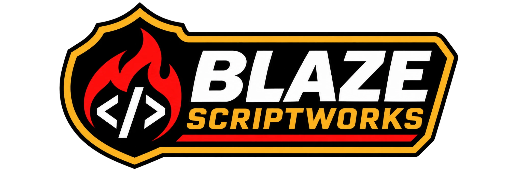
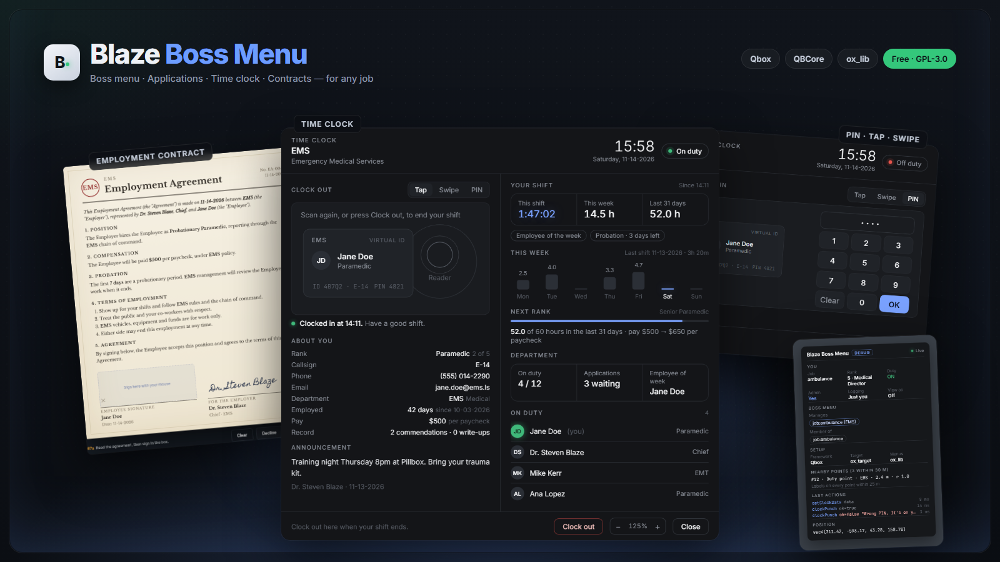
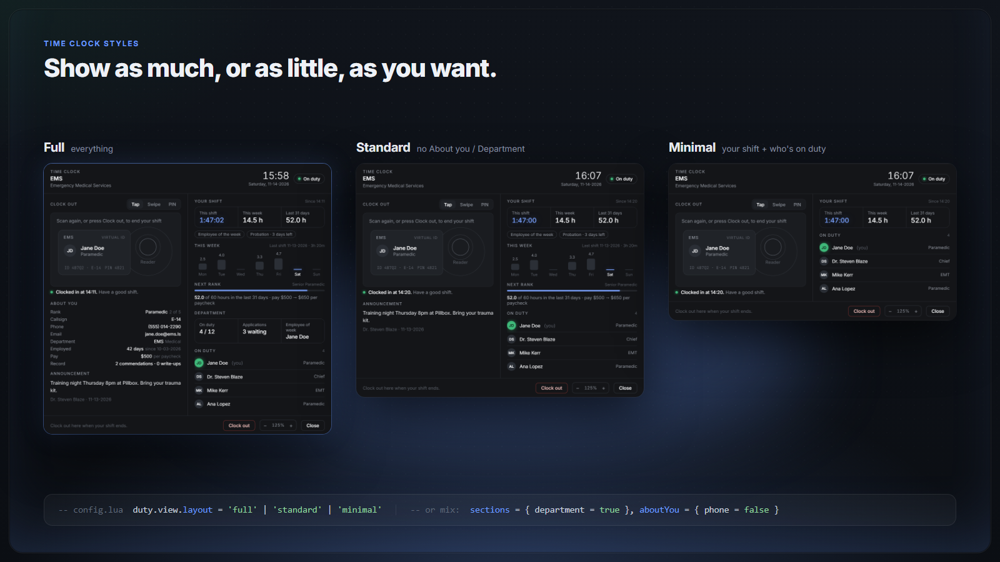
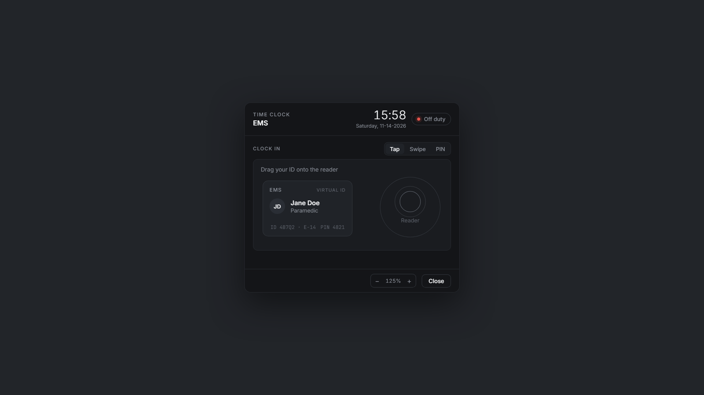
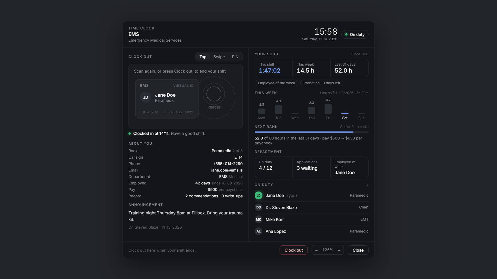
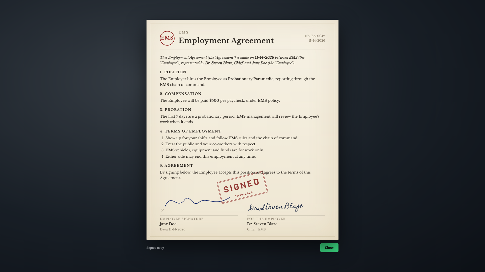
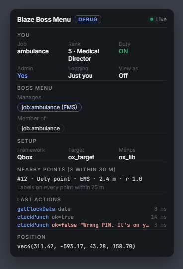

<p align="center"></p>
<p align="center"><a href="https://discord.gg/u6b6nCDJMa"></a></p>

# blaze_bossmenu

Boss menu + job application system for **any job** (EMS, fire, police, mechanic, …) and gangs.
Runs on **Qbox** and **QBCore**. Menus use **ox_lib** by default, with optional **Lation UI**; the employment contract,
the time clock and the debug panel are small web screens (`web/`).

Free and open source under **GPL-3.0** (see [License & credits](#license--credits)).
Support, updates and suggestions: **[Blaze Scriptworks Discord](https://discord.gg/u6b6nCDJMa)** (or GitHub issues).

It is a fork of [qbx_management](https://github.com/Qbox-project/qbx_management) (GPL-3.0) and replaces it:
everything qbx_management did is here, plus applications, funds, callsigns and in-game placement. See `NOTICE.md`.
It does **not** need Blaze Medical or any other Blaze resource.

## Screenshots





| Time clock (clock in) | Time clock (on duty) |
|---|---|
|  |  |
| **Employment contract** | **Debug panel** |
|  |  |

The boss menu itself uses ox_lib (or Lation UI) menus in game.

## Features

- **Staff**: list everyone in the job (online and offline) with rank, callsign, on duty / off duty / offline,
  hours worked and last check-in. Promote, demote, set callsign and fire.
- **Rank rules** (checked on the server): you only manage people *below* your rank, only promote up to the rank
  just below yours, and can't act on yourself (except your own callsign). Admins can manage any configured job.
- **Hire**: nearby players or by server ID. The person signs an **employment contract** first (or a simple
  Accept / Decline popup with `contract.enabled = false`).
- **Applications**: anyone applies at an application point. Managers review, invite to interview, mark as needing training
  (passed the interview, training before hire), accept & hire (picking the starting rank), or deny with a reason. Applicants are told right away, or on their next login.
  Managers can also review at a separate **application review point**, and applicants check theirs with `/applicationstatus`.
- **Form builder in game**: add, edit, reorder, delete and preview questions; edit the intro; save or reset to default.
  Old applications keep their own questions and answers, so they still read correctly after the form changes.
- **Funds**: society balance, deposit and withdraw cash (with a reason), confirm on big amounts, recent history.
- **Duty hours**: on/off duty time per employee, kept for 31 days (same table as qbx_management, so old hours carry over).
- **Rank editor** (Qbox): rename ranks, change pay, boss flag and bank access, saved across restarts.
- **Gangs**: members, hire, promote/demote, kick, rank editor, optional funds.
- **Admin menu**: `/bossmenuadmin` holds every admin tool: boss menus for any job or gang (full access), placing points,
  Show zones, debug, test tools and a settings overview. The boss menu itself stays roleplay only: at desks and in the
  radial menu admins are treated like anyone else.
- **Placement**: admins place boss desks, application, review, duty and wardrobe points where they're looking, as an
  invisible point, a PED or a prop.
  Managers can do the same for their own job from the boss menu (**Locations**): add, move, resize, delete, set a waypoint.
- **Time clock**: at a duty point, staff get a clean time clock screen with their virtual ID (name, rank, callsign, ID,
  personal PIN). They clock in by tapping the ID on the reader, swiping it, or typing the PIN (`duty.methods`). It shows
  a live shift timer, hours this week and the last 31 days, a bar per day, their last shift, progress to the next rank
  (`promotionHours` and real pay), tags (Employee of the week, probation, ready for promotion), who's on duty and the
  department announcement, an About you list (rank and position, callsign, department, time employed, pay,
  record) and department stats (on duty vs total staff, applications waiting for managers, Employee of the Week).
  Green / red shows on or off duty. The server checks they're at that job's duty point and the PIN.
  `duty.style = 'instant'` just toggles duty instead.
- **Job outfits**: managers save what they're wearing as a uniform with the lowest rank allowed; staff change at a **wardrobe** point.
  Uses illenium-appearance automatically when it's running; male and female outfits are separate; face and hair are never changed.
- **Radial menu**: bosses get a **Work** entry (ox_lib radial, works with qbx_radialmenu) with their boss menu, applications and My job.
- **Logs** to console, the ox_lib logger and Discord.
- **Compatibility** with scripts written for qbx_management or qb-bossmenu (e.g. illenium-appearance boss outfits).

### Extras (each can be turned off in `Config.features`, `Config.applications` or `Config.funds`)

**Staff**
- **Employee profiles**: hire date, phone and email (from the phone resource), probation, hours this week and this month, last check-in, rank history and record.
- **Commendations & write-ups** on an employee's record (write-ups only for people below you). They're told right away.
- **Probation**: new hires are on probation for `probationDays`; managers get a reminder when it ends.
- **Badges in the staff list**: Employee of the Week, Probation, Inactive (no duty in `inactiveDays`), Ready for promotion (`promotionHours`).
- **Employee of the Week**: announced to the whole department, with a big on-screen message for the winner.
- **`/myjob`**: staff see their own profile, record and the current department announcement.

**Applications**
- **Team votes**: managers vote for or against an application and see who voted what.
- **Quick replies**: ready-made deny reasons and interview messages (`applications.quickReplies`).
- **Withdraw**: applicants can withdraw an undecided application from `/applicationstatus`.
- **Interview check-in**: invited applicants "Check in for interview" at the review point, and online managers are told.
- **`/jobs` "Now hiring" board**: every job taking applications, with a waypoint to its application point.
- **Phone mail**: results also arrive as an email in sd-phone (if it's running).
- **Receptionist NPC**: stands behind each applications point and says hello.

**Money**
- **Bonuses**: pay one employee or everyone on duty from society funds, straight into their bank (`maxBonus` per person).
- **Daily withdrawal limits per rank** (`jobs[x].withdrawLimits`), covering withdrawals and bonuses. Admins aren't limited.
- **Payroll**: pay per rank, and what one paycheck costs for everyone / for staff on duty now.

**Employment contract**
- When someone is hired nearby, they get a real-looking **Employment Agreement** on screen instead of a plain Accept/Decline,
  and **sign it with the mouse**. A red SIGNED stamp lands on the page. Their character writes on a notepad meanwhile.
- It **fills itself in**: the job label, rank, pay, probation, the new hire's name, and the person hiring with their rank
  ("represented by Dr. Steven Blaze, Chief"). Placeholders: `{job}` `{rank}` `{pay}` `{probation}` `{employee}`
  `{manager}` `{manager_rank}` `{date}` `{number}`. A section that uses `{pay}` or `{probation}` drops out when it doesn't apply.
- **Edit it in game**: boss menu → **Employment contract**. Change the title and intro, add/edit/move/delete sections,
  preview it on paper, save, or reset to default. Each job has its own; the default is `contract.template` in config.lua.
- The signed copy (exact wording + signature) is kept, so editing the template later never changes old contracts.
  **View employment contract** in their profile or `/myjob` opens it again.
- Prefer typing? `contract.style = 'typed'`: a popup where they type their full name (checked on the server).
- Try it alone with `/bossmenutest` → **Preview: employment contract**, or open `web/contract.html` in a browser for a demo.

**Flair**
- **Celebrations**: big centre-screen message + sound for new hires, promotions, bonuses and Employee of the Week.
- **Handshake**: manager and new hire shake hands when a nearby hire is accepted.
- **Starter items** for new hires (`jobs[x].starterItems`, ox_inventory or the framework inventory).
- **Announcements**: on-duty staff see them now (with a sound), others when they clock in.
- **Activity log**: recent hires, fires, promotions, money moves and more, right in the boss menu.

## Commands

| Command | Who | What |
|---|---|---|
| `/bossmenuadmin` | Admins | Admin menu: boss menus for any job, points, Show zones, debug, test tools, settings (`adminCommand`) |
| `/bossmenutest` | Admins | Test staff and applications, View as…, previews (`testCommand`) |
| `/bossdebug [on|off|view|move]` | Admins | Debug: live panel, labels, action logs (`debugCommand`) |
| `/applicationstatus` | Everyone | Your job applications (`applications.statusCommand`) |
| `/myjob` | Staff | Your profile, record and the department announcement (`features.myJobCommand`) |
| `/jobs` | Everyone | "Now hiring" board with waypoints (`features.jobBoardCommand`) |

The boss menu itself opens at a boss desk or from the radial menu (**Work**) for bosses.

## Requirements

- [ox_lib](https://github.com/overextended/ox_lib)
- [oxmysql](https://github.com/overextended/oxmysql)
- Qbox (`qbx_core`) **or** QBCore (`qb-core`)
- `ox_target` or `qb-target` (optional: without one, points use a walk-up `[E]` prompt)
- For Funds: one of Renewed-Banking, qb-banking, okokBanking or qb-management
- Optional, used automatically when running:
  - `lation_ui` (menus), `illenium-appearance` (job outfits), `ox_inventory` (starter items)
  - a phone resource for phone number / email: sd-phone, lb-phone, high-phone, qs-smartphone(-pro), 17mov_Phone, npwd
  - sd-phone for application results by phone mail

## Install

1. Download the latest release and put the folder in your resources (for example `resources/[standalone]/blaze_bossmenu`).
   Keep the folder name **blaze_bossmenu**: other scripts call it as `exports.blaze_bossmenu`.
2. If you used **qbx_management**, stop it. blaze_bossmenu replaces it.
   Keep the folder, but move it somewhere that isn't ensured (for example `resources/[disabled]/qbx_management`).
   Scripts such as illenium-appearance check that the folder exists and then call `exports.qbx_management:…`;
   blaze_bossmenu answers those calls while qbx_management is stopped.
3. Add to `server.cfg` (after ox_lib, oxmysql, your framework and your target script):

```cfg
ensure blaze_bossmenu

# Discord logs. Set the webhook HERE only, never in a file.
set blaze_bossmenu_webhook "https://discord.com/api/webhooks/..."

# Who can use the admin menu (/bossmenuadmin) (framework admins also count)
add_ace group.admin blaze_bossmenu.admin allow

# Optional, Qbox: turn on the in-game rank editor (same convar qbx_management used)
setr qbx:enableGroupManagement "true"
```

If you use `ensure [standalone]` and the resource is in that folder, you don't need its own `ensure` line.
The database tables are created on first start.

## Adding jobs and gangs

Only jobs and gangs listed in `config.lua` get a boss menu. The key is the framework job/gang name.

```lua
jobs = {
    ambulance = { label = 'EMS', bossGrade = nil, society = 'ambulance', applications = true, funds = true },
    police    = { label = 'LSPD', bossGrade = nil, society = 'police', applications = true, funds = true },
    mechanic  = { label = 'Mechanic', bossGrade = 3, society = 'mechanic', applications = false, funds = true },
},
gangs = {
    lostmc = { label = 'The Lost MC', bossGrade = nil, society = 'lostmc', funds = false },
},
```

- `bossGrade = nil` uses the grade's **isboss** flag from your framework. A number makes that grade and above managers.
- `society` is the bank/society account used for Funds.

## Placing points

Use `/bossmenuadmin` → **Points** in game (admins only). Every point first asks **what stands there**: an
**invisible point**, a **PED** (model and idle from `pointLooks`, or type any model) or a **prop**. PEDs stand still:
they never wander off, flee or react. With ox_target / qb-target you aim at the PED or prop itself.


- **Add boss desk**: pick the job or gang, aim at the spot and press **E** (Backspace cancels). While aiming you see a
  **preview**: the zone ring at its real size in its color, a line for the way it faces, and a see-through PED or prop
  exactly where (and how) the real one will stand. Change the size with the **mouse wheel** or **↑ / ↓** (0.5-5 m) and
  turn the PED / prop with **← / →**. **Page Up / Page Down** raise or lower the point and its PED / prop (±2 m),
  for counters, upper floors or uneven ground.
  The game HUD and minimap hide while you place. To hide your HUD resource too, set `placementHud` in config.lua
  (a function that hides / shows it), or listen to the client event `blaze_bossmenu:client:placing` (true / false). Press **G** on the card to switch **Output** to **Copy config line**:
  E then copies a ready `config.lua > locations` line (job, type, coords, heading, size) to your clipboard and F8
  instead of saving the point. Moving a point in **Manage points** can export the same way.
- **Add applications point**: same, but only for jobs with applications on.
- **Add application review point**: where managers review that job's applications (for example an HR office),
  without needing the boss desk. Only that job's managers (and admins) see it.
- **Add duty point**: staff of that job clock in and out here.
- **Add wardrobe**: staff of that job change into the job's outfits here (and back to their own clothes).
- **Manage points**: everything placed, grouped by job. **Teleport** to a point, **Move** it (aim at the new spot,
  press E; it keeps its job, type, size and look, and you can turn it), **Change look** (invisible / PED / prop, stays
  where it is), **Change size** (scroll on the spot with a live ring, E saves), or **Delete** it.
  Points from `Config.locations`, or added by other scripts, can't be changed in game.

**Show zones** (in `/bossmenuadmin`, and in Locations for a manager's own job) draws every point as a colored ring on the ground
with a label, so you can see exactly where each target is and how big it is. Only you see it.
**Debug** (admins):

| Command | What it does |
|---|---|
| `/bossdebug` or `/bossdebug on` / `off` | Debug for everyone's boss menu actions in the server console, plus your own live panel |
| `/bossdebug view` | Just your own live panel and point labels |
| `/bossdebug move` | Move and resize your panel: drag it, mouse wheel or − / + for size, 70-150% (remembered on your PC; Enter = done, Esc = cancel) |

The live panel (top right, refreshed 4 times a second) shows your job, rank, duty, admin and View-as state, the groups
you manage and belong to, framework / target / menu library, the nearest point (id, type, distance, radius), your last
boss menu actions with their result and time, and your position. Point labels show id, radius and distance.
**Debug mode** in `/bossmenuadmin` turns the same thing on for just you, and **Move / resize debug panel** there moves and resizes it. `debug = true` in config.lua turns it on for everyone.

Managers can place, move and delete their own job's points from the boss menu → **Locations**
(`managerPlacement`: which types, and whether they may teleport).

Boss desks and review points only show to that job's managers (and admins). Application points show to everyone.

## Checking your applications

`/applicationstatus` (or "My application status" at an application point) opens **My applications**:
every job you applied to, with the status (waiting, interview, needs training, accepted, denied), the interview and training messages,
the deny reason and when you can apply again, who reviewed it, and your own answers. Manager notes are never shown.
Change or turn off the command with `applications.statusCommand`.

## Testing on your own

`/bossmenutest` (admins) opens test tools:

- **Add 4 test staff** to a job or gang: one on probation, one inactive, one ready for promotion with a commendation,
  and one regular. They're real offline characters (citizen IDs `BMTEST01`, `BMTEST02`, …) that nobody can log in as,
  so you can promote, demote, write up, commend, set callsigns and fire them.
- **Add 3 test applications** using the job's current form: two waiting, one invited to an interview. Accepting one hires that test character.
- **View as…**: see a job exactly as a **civilian** (not in it), a **regular employee**, or **any rank** including command / boss ranks.
  While it's on, you count as that person (no admin, that rank's limits), and a reminder shows at the top of the screen.
  **Stop preview** puts you back (it also resets when you disconnect). Anything you do while previewing is real.
- **Previews** of the promotion celebration, the hire offer popup, the employment contract and the announcement popup.
- **Remove all test data**: deletes every test character and everything linked to them.

Things that need a real second player: hiring someone nearby (consent popup + handshake) and bonuses (paid to online players).
Turn the command off with `testCommand = false` once you go live.

## Building the application form

Boss menu → Applications → **Edit application form**:

- **Add question**: question text, type (Short answer, Long answer, Number, Dropdown, Checkbox) and Required,
  then what that type needs: min/max length, min/max number, or the dropdown options (one per line, 2-10).
- Pick a question to **Edit**, **Move up**, **Move down** or **Delete** it.
- **Edit intro text** (up to 500 characters), **Preview form** (exactly what applicants see, nothing is sent).
- Changes are a draft until **Save form**. Leaving with unsaved changes asks "Discard changes?".
- **Reset to default** deletes the saved form and goes back to `Config.applications.defaultQuestions`.

The applicant's full name always comes from their character. It is never a question.

## Config options

| Option | What it does |
|---|---|
| `enabled` | `false` = the whole resource does nothing. Saved data stays in the database. |
| `debug` | Log every action to the server console and draw all points for everyone (testing only). Admins can turn debug on just for themself in `/bossmenuadmin`. |
| `debugCommand` | Admin debug command (default `bossdebug`). |
| `testCommand` | Admin test tools command (default `bossmenutest`), or `false` once you go live. |
| `versionCheck` | On start, compare with the latest GitHub release and say if there's an update. |
| `useLationUI` | `true` = menus, forms and confirms use Lation UI. Falls back to ox_lib if lation_ui isn't started. |
| `target` | `'auto'`, `'ox_target'`, `'qb-target'` or `'none'` (walk-up `[E]` prompt). |
| `adminAce` | Ace for the admin menu and its tools. Framework admins also count. |
| `adminCommand` | Admin menu command (default `bossmenuadmin`). |
| `adminsCanManage` | Admins can open any configured job's or gang's boss menu with full access, from the admin menu only (**Boss menus**). |
| `targetDistance` | How close you must be to use a point with ox_target / qb-target (PEDs and props: +0.5 m). |
| `pointLooks.*` | What can stand at a point: `peds` and `props` (label + model) and PED `idles` (scenario or `anim = { dict, name }`). |
| `hireDistance` | How close (m) someone must be to be hired. |
| `hireConsent` / `hireConsentSeconds` | Accept/Decline popup for the person being hired, and how long they have. |
| `contract.*` | Employment contract: `enabled`, `style` (`'paper'` mouse / `'typed'`), `seconds`, `requireExactName` (typed), `animation`, `editor` (`'management'` / `'admin'` / `false`), `template`. |
| `activity.*` | Duty hours: on/off, shortest shift saved, days kept, date format. |
| `gradeEditor` | In-game rank editor (Qbox, also needs `qbx:enableGroupManagement "true"`). |
| `qbxManagementCompat` | Answer qbx_management exports and qb-bossmenu events while qbx_management is stopped. |
| `jobs` / `gangs` | Which groups get a boss menu, and their per-group switches. |
| `applications.enabled` | `false` = applications off everywhere (the boss menu still works). |
| `applications.startOpen` | Whether applications start open. Managers can open/close them in game. |
| `applications.denyCooldownHours` | Wait after a denial before applying to the same job again. |
| `applications.contact` | The applicant's phone number and email, pulled from their phone and sent with the application (`phone`, `email`). With `phoneRequired` / `emailRequired` they're told to set them up on their phone before they can apply. |
| `applications.age` / `minAge` | The applicant's age from their character's birthdate, shown on the form and sent with the application. `minAge` = youngest age that can apply (`nil` = no minimum). |
| `applications.statusCommand` | Command for "My applications" (default `applicationstatus`), or `false` for none. |
| `applications.formEditor` | `'management'` (managers + admins), `'admin'` (admins only) or `false` (no in-game editing). |
| `applications.maxQuestions` | Most questions a form can have. |
| `applications.intro` / `defaultQuestions` | The starting form for every job. |
| `funds.enabled` | `false` = no Funds anywhere. |
| `funds.confirmAbove` | Deposits/withdrawals of this amount or more ask to confirm. |
| `funds.historyLimit` | Transactions shown in Recent history. |
| `applications.allowWithdraw` / `votes` / `interviewCheckIn` | Applicant withdraw, manager votes, interview check-in at the review point. |
| `applications.clearData` | Who sees **Clear application data** in Hiring settings: `'management'`, `'admin'` or `false`. Deletes closed or all applications of the job (the form is kept). |
| `applications.quickReplies` | Ready-made `deny`, `interview` and `training` messages. |
| `funds.bonuses` / `maxBonus` / `payroll` | Bonuses from society funds, biggest bonus per person, the Payroll page. |
| `jobs[x].description` | Text shown on the `/jobs` board. |
| `jobs[x].fullName` | Full job name shown under the label on the time clock (e.g. Emergency Medical Services). |
| `jobs[x].promotionHours` | `{ [rank] = hours }` needed to show "Ready for promotion". |
| `jobs[x].withdrawLimits` | `{ [rank] = amount }` most that rank can withdraw + pay in bonuses per day. |
| `jobs[x].starterItems` | `{ { item = 'radio', count = 1 } }` given to new hires. |
| `features.profiles` / `records` | Employee profiles (+ `/myjob`) and commendations / write-ups. |
| `features.probationDays` / `inactiveDays` | Probation length and the Inactive badge (0 = off). |
| `features.announcements` / `employeeOfWeek` / `auditLog` | Announcements, Employee of the Week, Activity log (`auditShow`, `auditKeepDays`). |
| `features.celebrations` / `handshake` | On-screen celebrations and the hire handshake. |
| `features.myJobCommand` / `jobBoardCommand` | `/myjob` and `/jobs` command names, or `false`. |
| `features.phoneMail` / `phoneMailDelay` | Send application results by sd-phone mail, after a random delay (`{ min = 15, max = 45 }` seconds). |
| `features.receptionist` | NPC at applications points: `enabled`, `model`, `scenario`, `greet`. |
| `duty.*` | Duty points: `enabled`, `style` (`'clock'` screen / `'instant'` toggle), `methods` (`'tap'`, `'swipe'`, `'keypad'`), `size` (starting size of the time clock; players change their own), `view` (what the full time clock shows: `layout` = `'full'` / `'standard'` / `'minimal'`, `sections` to turn single parts on or off, `aboutYou` to pick the About you lines; phone / email turned off aren't looked up). |
| `outfits.*` | Job outfits: `enabled`, `appearance` (`'auto'` = illenium-appearance if running, `'native'`), `maxPerJob`. |
| `contact.*` | Phone + email on the time clock and in profiles: `enabled`, `phone` (`'auto'` or a resource name), optional `getPhone` / `getEmail` functions. Auto-detects sd-phone, lb-phone, high-phone, qs-smartphone-pro, qs-smartphone, 17mov_Phone, npwd, then the character's own phone. |
| `managerPlacement.*` | Managers place their own job's points: `enabled`, `types`, `teleport`. |
| `radial.*` | "Work" radial entry for bosses: `enabled`, `label`, `icon`; `admin` / `adminLabel`: a separate "Boss admin" entry for admins. |
| `locations` | Fixed points from config (added to the ones placed in game). Types: boss, applications, review, duty, outfits. |
| `logs.*` | Console, ox_lib logger, Discord, and each event on/off. |

### On/off switches (all enforced on the server)

- **Whole resource**: `enabled = false`. Nothing loads; saved points come back when turned on.
- **Per job**: a job not in `jobs` gets nothing, and the server refuses everything for it.
- **Applications**: on for a job only if `applications.enabled` **and** `jobs[job].applications`.
- **Form editor**: `applications.formEditor = false` hides "Edit application form" and the server refuses edits.
- **Funds**: on only if `funds.enabled` **and** `jobs[job].funds` **and** a supported banking resource is running.

## Discord logs

Set `set blaze_bossmenu_webhook "https://discord.com/api/webhooks/..."` in `server.cfg`.
The webhook is **never** read from a file, so it can't end up in the repo. Logs are batched to stay under Discord's rate limit.
Events: hire, fire, promote, demote, callsign, accept, deny, interview, training, clearApps, deposit, withdraw, toggle, formEdit,
formReset, placement, gradeEdit, record, eotw, announce, bonus, withdrawApp, checkin, contractEdit, outfit.
Turn single events off in `Config.logs.events`.

## Lation UI

`useLationUI` is optional. Lation UI isn't a dependency and no Lation files are included.
With it on: confirm popups get colours (red for Fire/Deny, orange for Withdraw/Reset), Fire shows a
"This removes them from the job" note, and staff icons are coloured (green on duty, gray offline).
If your server runs **Lation's ox_lib fork**, ox_lib itself forwards menus to lation_ui while it's started,
so you'll see Lation UI even with `useLationUI = false`.

## Exports

Client:

```lua
exports.blaze_bossmenu:openBossMenu('ambulance')          -- opens if the player manages that job
exports.blaze_bossmenu:openApplication('ambulance')       -- the apply flow
exports.blaze_bossmenu:openApplicationStatus('ambulance') -- shows their application status
```

Server:

```lua
exports.blaze_bossmenu:isManager(source, 'ambulance')        -- true/false (jobs)
exports.blaze_bossmenu:isManager(source, 'lostmc', 'gang')   -- gangs
```

qbx_management-style exports, also answered as `exports.qbx_management:*` while qbx_management is stopped:

```lua
-- client
exports.blaze_bossmenu:OpenBossMenu('job')  -- or 'gang'
local id = exports.blaze_bossmenu:AddBossMenuItem({ title = 'My item', icon = 'fa-solid fa-star', event = 'my:event', args = { type = 'job' } })
exports.blaze_bossmenu:RemoveBossMenuItem(id)  -- AddGangMenuItem / RemoveGangMenuItem for gangs
-- server
exports.blaze_bossmenu:RegisterBossMenu({ groupName = 'ambulance', type = 'job', coords = vec3(0, 0, 0) })
```

Events `qb-bossmenu:client:OpenMenu` and `qb-gangmenu:client:OpenMenu` open the job / gang menu.

## Database tables

`blaze_boss_applications`, `blaze_boss_forms`, `blaze_boss_callsigns`, `blaze_boss_fund_log`,
`blaze_boss_settings`, `blaze_boss_points`, `blaze_boss_members`, `blaze_boss_records`, `blaze_boss_audit`,
`blaze_boss_announcements`, `blaze_boss_eotw`, `blaze_boss_app_votes`, `blaze_boss_contract_templates`, `blaze_boss_contracts`, `blaze_boss_outfits`, plus `player_jobs_activity` and `management_groups`
(the same tables qbx_management used).

## License & credits

blaze_bossmenu is free software under the **GNU General Public License v3.0** (`LICENSE`).
It is a fork of [qbx_management](https://github.com/Qbox-project/qbx_management) by the **Qbox Project**, also GPL-3.0;
`NOTICE.md` lists what came from it and what changed. If you share a modified version, keep it under GPL-3.0 and share
its source code. Fonts on the web screens load from Google Fonts (SIL OFL 1.1 / Apache 2.0) and aren't bundled.

See `CHANGELOG.md` for what's new.
