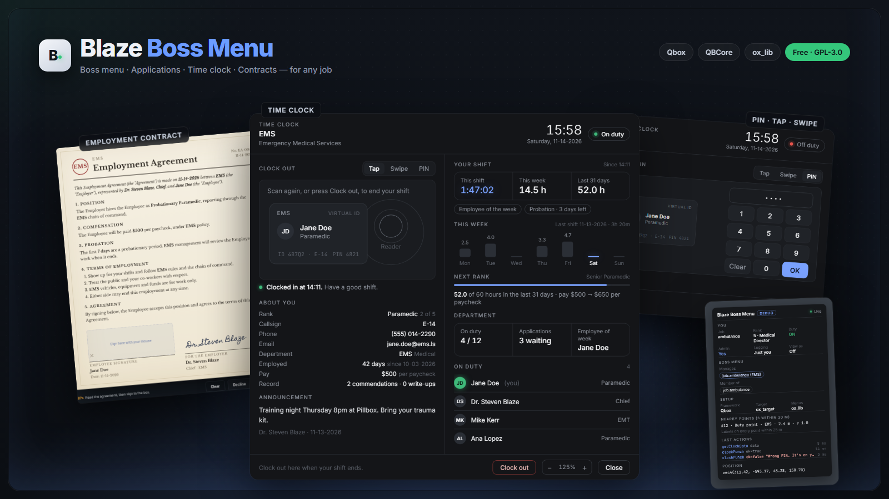
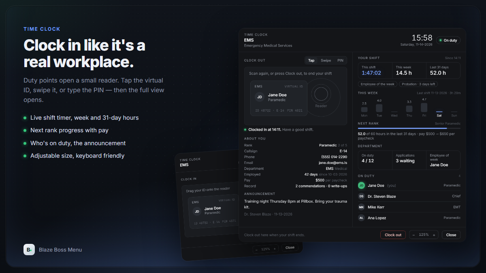
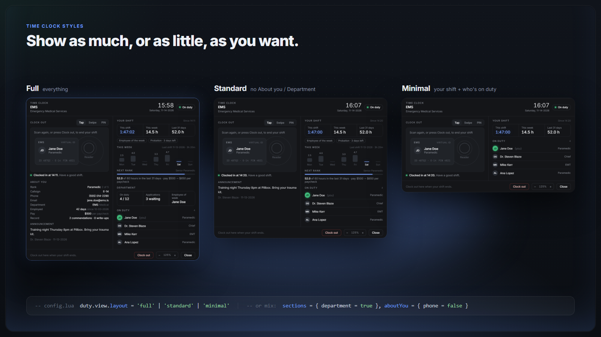
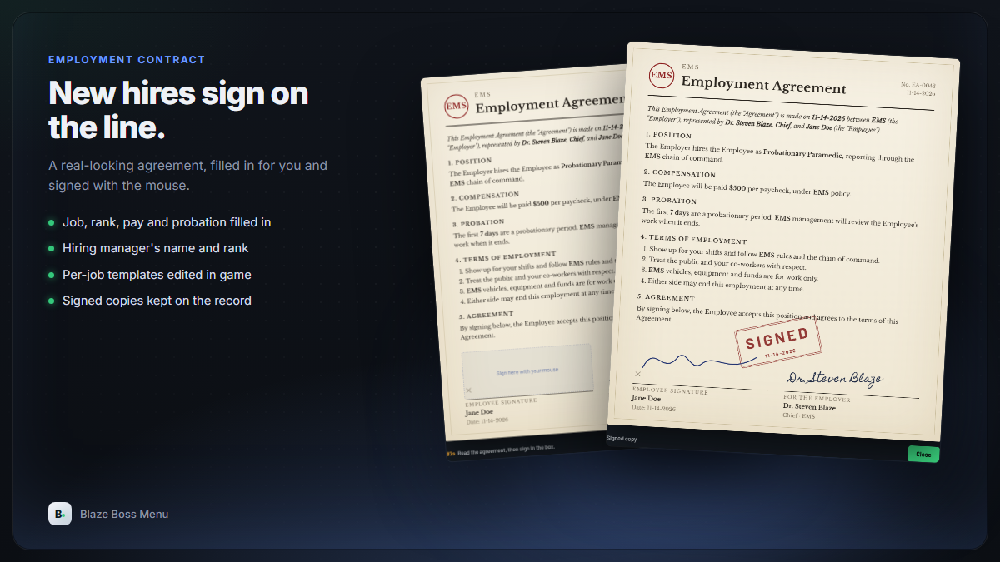
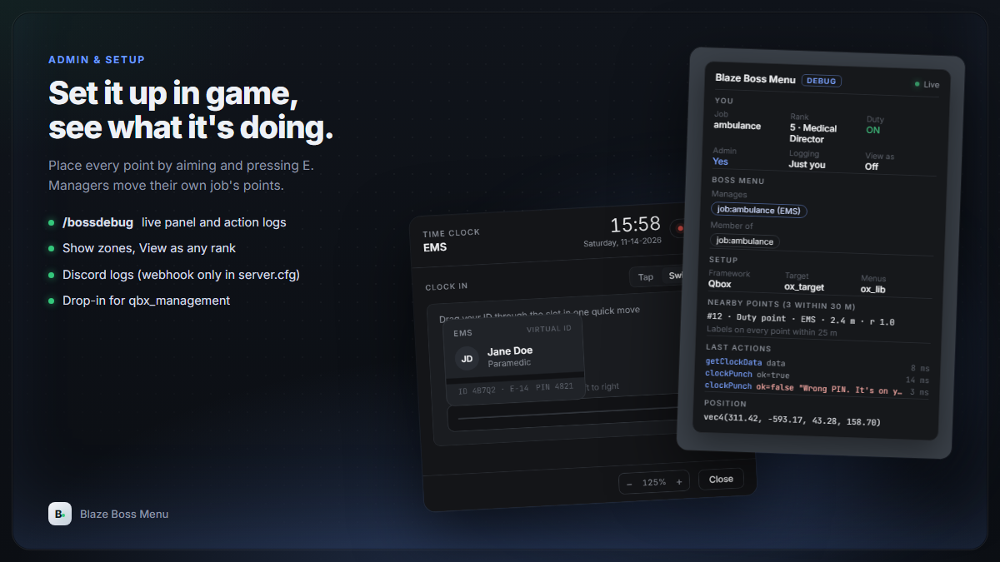

# [FREE] [QBOX/QBCORE] Blaze Boss Menu: boss menu, applications, time clock & contracts for any job

<!-- Release post for the Cfx.re forum (Releases > Free) and Discord. Paste everything below the title.
     Images load from GitHub once the repo is public. Add an in-game boss menu screenshot/GIF where marked if you like. -->

**Blaze Boss Menu** is a complete management system for any job (EMS, police, fire, mechanics, businesses) and gangs.
It replaces **qbx_management** (it's a GPL-3.0 fork of it) and adds job applications, a time clock, signed employment
contracts, funds, outfits, profiles and admin tools, all configurable and all checked on the server.

Free and open source (GPL-3.0). Works on **Qbox** and **QBCore** with **ox_lib** (optional **Lation UI**).

<!-- optional: add an in-game screenshot or GIF of the boss menu here -->

## Features

**Boss menu**
- Staff list (online and offline): rank, callsign, on duty / off duty, hours, badges (probation, inactive, ready for promotion, Employee of the Week)
- Hire nearby or by ID, promote, demote, fire, callsigns, with server-side rank rules
- Employee profiles, commendations and write-ups, announcements, Employee of the Week, activity log
- Funds: deposit, withdraw, bonuses, payroll, per-rank daily limits (Renewed-Banking, qb-banking, okokBanking, qb-management)
- Rank editor (Qbox), gang menus, radial menu entry for bosses

**Applications**
- Application points anyone can use, review points for managers
- In-game form builder (short/long answer, number, dropdown, checkbox), preview, reset
- Interview invites with check-in, team votes, quick replies, deny reasons with cooldown
- `/applicationstatus` for applicants, `/jobs` "Now hiring" board, phone mail results (sd-phone)

**Time clock**
- Clock in by tapping a virtual ID on the reader, swiping it, or typing your PIN
- Live shift timer, hours this week and month, next rank progress with pay, who's on duty, the announcement
- Clean modern design, adjustable size, scans while on duty just open it; Clock out button
- Pick the style in config: **full**, **standard** or **minimal**, or turn single sections and About you lines on and off

**Employment contract**
- New hires sign a real-looking contract with the mouse, filled in automatically (job, rank, pay, probation, hiring manager)
- Per-job templates edited in game; signed copies kept on the employee's record

**And more**
- Duty points, job outfits and wardrobes (illenium-appearance), starter items (ox_inventory)
- Phone number / email from sd-phone, lb-phone, high-phone, qs-smartphone(-pro), 17mov_Phone, npwd
- Admins and managers place points in game (aim + E), Show zones, `/bossdebug` live debug panel, `/bossmenutest` test tools with "View as"
- Console, ox_lib logger and Discord logs (webhook only in server.cfg)
- Drop-in for qbx_management / qb-bossmenu: keeps their tables, exports and events

## Requirements
- ox_lib, oxmysql
- Qbox (qbx_core) or QBCore (qb-core)
- Optional: ox_target or qb-target, lation_ui, illenium-appearance, ox_inventory, a supported phone and banking resource

## Download
- Download: https://github.com/Strightblazing/blaze_bossmenu/releases/latest
- GitHub: https://github.com/Strightblazing/blaze_bossmenu
- Setup and every config option: README on GitHub

| | |
|---|---|
| Code is accessible | Yes |
| Subscription-based | No |
| Lines (approximately) | ~7,300 |
| Requirements & dependencies | ox_lib, oxmysql, Qbox or QBCore |
| Support | Yes (GitHub issues) |

Based on [qbx_management](https://github.com/Qbox-project/qbx_management) by the Qbox Project. Licensed under GPL-3.0.
